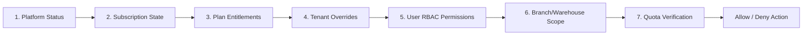

# Architecture Document - BusinessSuite

## 1. System Overview

BusinessSuite is an enterprise-grade, multi-tenant B2B SaaS platform for Sales, Purchases, Inventory Management, CRM, and Operational Treasury. It supports both multi-tenant SaaS mode and standalone single-tenant on-premise deployment.

```mermaid
flowchart TD
    Client[Next.js Web Client\nRTL/LTR, TailwindCSS] -->|HTTPS / REST API| Gateway[NestJS Modular Monolith API]
    
    subgraph NestJS [Backend Application Layer]
        AuthGuard[Auth & Session Guard]
        TenantGuard[Tenant Context & Membership Resolver]
        EntitlementGuard[Dynamic Entitlements & Feature Gate]
        RBACGuard[Role & Permission Guard]
        
        subgraph CoreModules [Business Modules]
            PlatformModule[Platform Admin & Plans]
            EntitlementsModule[Dynamic Entitlements Engine]
            TenantModule[Tenants & Users & RBAC]
            InventoryModule[Inventory & Stock Movements (WAC)]
            SalesModule[Sales, Quotes & Invoices]
            PurchasesModule[Purchases, POs & Vendor Bills]
            ReturnsModule[Sales & Purchase Returns]
            TreasuryModule[Treasury, Cash/Bank & Payments]
            CRMModule[CRM Leads, Pipelines & Tasks]
            ReportsModule[Reports & Analytics Engine]
            AuditModule[Audit Log & Activity Tracker]
        end
    end
    
    Gateway --> AuthGuard
    AuthGuard --> TenantGuard
    TenantGuard --> EntitlementGuard
    EntitlementGuard --> RBACGuard
    RBACGuard --> CoreModules
    
    CoreModules -->|Prisma ORM + RLS Client| DB[(PostgreSQL Database\nRow Level Security + Decimal)]
    CoreModules -->|File Storage Adapter| Storage[Local Disk / S3 Compatible Storage]
    CoreModules -->|Cache & Session Store| Cache[Redis / In-Memory Cache]
```

---

## 2. Multi-Tenancy & Isolation Model

### 2.1 Identity vs Membership Model
- **User**: Global identity representing a physical person (email, password hash, MFA status, profile).
- **Tenant**: Independent organization/company using the system.
- **Membership**: Junction entity binding a `User` to a `Tenant` with assigned `Role`, branch/warehouse scope, and status (`ACTIVE`, `SUSPENDED`).
- **Platform Owner / SuperAdmin**: Dedicated platform management privileges separated strictly from tenant-level operations.

### 2.2 Tenant Context Resolution
1. The client presents an authenticated session/JWT token.
2. The incoming request includes `X-Tenant-Id` header only as a target selector.
3. The server validates that the authenticated `User` has an `ACTIVE` `Membership` in that specific `Tenant`.
4. Tenant ID is injected into the request-scoped execution context and **never trusted blindly** from client payloads.
5. All database operations automatically apply tenant filtering:
   - Application-level: Explicit `where: { tenantId }` and composite foreign keys `@@unique([tenantId, id])`.
   - Database-level: PostgreSQL Row-Level Security (RLS) policies enforcing `current_setting('app.current_tenant_id')`.

---

## 3. Dynamic Entitlements & Feature Engine

The system uses a 7-layer authorization and entitlement resolution pipeline:



### 3.1 Feature Catalog
A strict registry of code-backed features:
- `sales.core`, `sales.quotations`, `sales.returns`
- `purchases.core`, `purchases.orders`, `purchases.returns`
- `inventory.core`, `inventory.transfers`, `inventory.stocktake`
- `crm.contacts`, `crm.leads`, `crm.pipeline`
- `finance.cashbank`, `finance.payments`, `finance.allocations`
- `reports.basic`, `reports.advanced`, `reports.cost_visibility`
- `branding.custom`, `staff.custom_roles`, `tools.import_export`

### 3.2 Real-time Invalidation
- Changes made in the Platform Owner Dashboard to plans or tenant feature overrides immediately invalidate cached entitlements for affected tenants without server restart or redeployment.

---

## 4. Financial & Inventory Consistency Rules

### 4.1 Costing & Valuation
- **Methodology**: Moving Weighted Average Cost (WAC).
- **Formula**: `New_Average_Cost = (Existing_Value + Incoming_Value) / (Existing_Qty + Incoming_Qty)`.
- **Negative Stock**: Prohibited. Any stock movement attempting to reduce stock below 0 within a warehouse is rejected with atomic transaction rollback.
- **Historic Freezing**: Unit cost is snapshotted upon invoice posting to guarantee historical Gross Profit integrity.

### 4.2 Document Lifecycle & Idempotency
- **Lifecycle**: `DRAFT` $\rightarrow$ `POSTED` $\rightarrow$ (Optionally `CANCELLED` via reversing transaction).
- **Posting Invariance**: Posted documents are immutable. Corrections require dedicated credit notes, debit notes, or return documents.
- **Stock Movement Binding**:
  - Quotes and Purchase Orders: No stock or accounting impact.
  - Sales Invoice Posting: Deducts stock & creates receivable balance atomically.
  - Purchase Invoice Posting: Adds stock & creates payable balance atomically.
- **Concurrency & Numbering**: Document numbers generated using atomic sequence counters per tenant and fiscal year (`tenant_id, document_type, year`).

---

## 5. Technology Stack & Directory Structure

- **Monorepo Root**:
  - `apps/api`: NestJS application (TypeScript strict mode, Prisma ORM, OpenAPI/Swagger).
  - `apps/web`: Next.js 14+ (App Router, TailwindCSS, Lucide icons, i18n RTL/LTR).
  - `packages/shared`: Shared types, interfaces, validation schemas, calculation helpers.
  - `docker/`: Dockerfiles and docker-compose configurations.
  - `scripts/`: Backup, restore, and deployment automation scripts.
