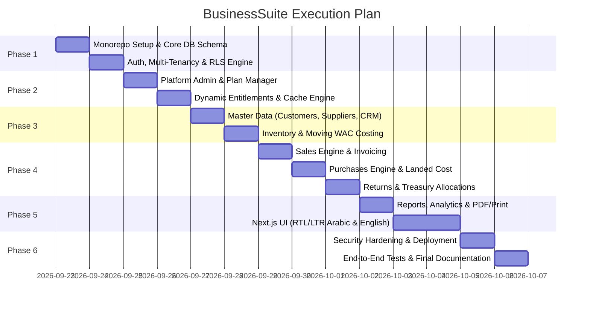

# Implementation Plan - BusinessSuite Commercial ERP/SaaS Platform

A complete, production-ready, multi-tenant commercial SaaS system for Sales, Purchases, Inventory Management, CRM, Operational Finance, and Dynamic Entitlements.

---

## 1. Phased Execution Roadmap

---

## 2. Detailed Phase Breakdown

### Phase 1: Foundation, Multi-Tenancy & IAM
- [ ] Initialize TypeScript Monorepo (NestJS `apps/api`, Next.js `apps/web`, `packages/shared`).
- [ ] Implement Prisma schema with `Tenant`, `User`, `Membership`, `Role`, `Permission`, `AuditLog`, `Session`.
- [ ] Configure PostgreSQL Row-Level Security (RLS) policies and tenancy interceptor.
- [ ] Implement Authentication with bcrypt, refresh tokens, MFA for platform admins, and tenant context switcher.
- [ ] Run automated tests for tenant isolation and cross-tenant leakage prevention.

### Phase 2: Platform Owner Dashboard & Dynamic Entitlements
- [ ] Implement Feature Catalog registry in backend with dependencies.
- [ ] Implement Plan Management (CRUD, Plan Versions, Quotas, Pricing fields).
- [ ] Implement Subscription Lifecycle (Trial, Active, Grace, Suspended, Expired) with manual billing logs.
- [ ] Implement Tenant Overrides (Allow/Deny features, custom quotas per tenant).
- [ ] Build Entitlements Engine with instantaneous Redis/In-memory cache invalidation on plan changes.
- [ ] Create Platform Owner web interface (Tenants, Plans, Subscriptions, Overrides, Audit Logs).

### Phase 3: Master Data, CRM & Inventory Core
- [ ] Implement Parties module: Customers & Suppliers (isolated accounts, credit limits, opening balances).
- [ ] Implement CRM module: Leads, Opportunities, Pipeline stages, Tasks, Lead-to-Customer conversion.
- [ ] Implement Inventory module: Items, Non-stock Services, Categories, Units with conversion rates.
- [ ] Implement Warehouses & Branches with strict membership scoping.
- [ ] Implement Moving Weighted Average Cost (WAC) engine, Opening stock batches.
- [ ] Implement Stock Transfers, Stocktake/Adjustments, and negative stock prevention checks.

### Phase 4: Commercial Operations (Sales, Purchases, Returns, Treasury)
- [ ] Implement Sales module: Quotations, Invoices (Cash/Credit), Taxes, Item Discounts, Draft $\rightarrow$ Posted workflow.
- [ ] Implement Purchases module: Purchase Orders, Vendor Bills, Stock addition, Landed cost calculation.
- [ ] Implement Returns module: Sales & Purchase returns strictly validating remaining returnable quantities.
- [ ] Implement Treasury module: Cash boxes, Bank accounts, Receipt vouchers, Payment vouchers, Multi-invoice allocation.
- [ ] Implement Atomic transaction wrappers, Idempotency keys, and Concurrency safety.

### Phase 5: Reports, Analytics & Bilingual Next.js UI
- [ ] Implement Reporting Engine: Sales analysis, Stock valuation, Aging reports, Cash/Bank statements, Gross Profit.
- [ ] Implement Cost protection: Mask item cost in reports/exports for unauthorized roles.
- [ ] Build Next.js Dashboard UI with TailwindCSS, full RTL/LTR bilingual support (Arabic default, English toggle).
- [ ] Implement Printable Invoices and Statement of Account templates formatted for Arabic printing.
- [ ] Build Entitlement Gates on the UI (hide or lock features based on real-time server permissions).

### Phase 6: Security Hardening, Independent Deployment & Final Verification
- [ ] Add Security headers, Rate limiting, CORS, CSRF protection, and Secure File Uploads.
- [ ] Implement Single-Tenant mode toggle (`DEPLOYMENT_MODE=SINGLE_TENANT`).
- [ ] Create Dockerfiles, Docker Compose files, and automated database backup & restore scripts.
- [ ] Run full test suite: Unit tests, Integration tests (on live PostgreSQL), and Playwright E2E browser flows.
- [ ] Produce complete deployment documentation, user guides, OpenAPI specs, and release checklist.
